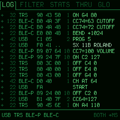
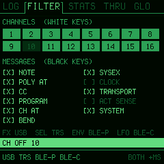
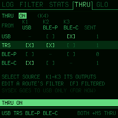

# MIDIMON for the M-VAVE FM-1

A MIDI monitor and thru router for the M-VAVE FM-1, in a green phosphor terminal's look. It shows every MIDI message
that comes in from USB, the TRS jack and Bluetooth, in hex, in words or both, and passes MIDI on between them.

**Status: early (0.2).** It runs on the FM-1. Expect changes.

  

## A Bluetooth MIDI dongle you already have

With THRU on, the FM-1 is an improvised wireless MIDI interface, in the way of a WIDI or a CME dongle, that also
shows you what passes through it. It is both a Bluetooth MIDI device (a computer or an iPad connects to it: `BLE-P`)
and a Bluetooth MIDI host (it connects to a Bluetooth controller or synth itself: `BLE-C`), at the same time. The
THRU screenshot above is one such setup:

- `TRS → USB, BLE-P`: a hardware synth's MIDI OUT on the jack reaches the computer over the cable and an iPad over
  Bluetooth.
- `BLE-C → USB`: a Bluetooth MIDI controller shows up on the computer as a USB MIDI device, with no Bluetooth on
  the computer at all.
- `USB → BLE-C`: the DAW plays a Bluetooth synth.

Any source can go to any number of outputs (never back to itself), and each route has its own filter: only channel 1
notes from the Bluetooth controller, no clock to the iPad, and so on. The FM-1 has no MIDI OUT jack, so the outputs
are USB, BLE-P and BLE-C.

## What it does

- **Four sources**, each its own: `USB`, `TRS` (the MIDI IN jack), `BLE-P` (a computer or tablet connected to the
  FM-1 over Bluetooth: the FM-1 is the peripheral) and `BLE-C` (a Bluetooth MIDI device the FM-1 connected to: the
  FM-1 is the central). Both Bluetooth roles at once.
- **Everything as it came**: SysEx (assembled, the maker named, its length), system common, clock and transport,
  active sensing, reset, running status (marked), and the faults: a stray byte, a message cut short, a SysEx without
  its end, messages lost to a full buffer.
- **LOG**: the last 4096 messages, HEX, HUMAN or BOTH, the time between lines or since power-on; pause, scroll back.
  ALGO turns what the LOG tab shows:
  - **KEYS**: the notes held on each channel across all 128 notes, and a keyboard zoomed to where they are, with
    each note's velocity and its poly pressure. Counts note-ons for notes already held and note-offs for notes not
    held: where stuck notes come from.
  - **CC**: pitch bend and channel pressure as graphs over the last seconds, the controllers last moved as bars,
    by channel and number: a row stays where it is while its knob turns (the one just moved glows).
  - **CHANS**: each channel's activity per source, and its last message.
  - **CLOCK**: the tempo coming in, running or stopped, the beat, the position (bar.beat.16th, song position
    pointer), the clocks' spacing (min, average, max), MIDI timecode put together from its quarter frames.
- **FILTER**: per source, per channel (white keys), per message type (black keys). Clock and active sensing hidden by
  default, as in MIDI-OX.
- **STATS**: messages and bytes per source, messages a second, what was lost and sent, Bluetooth's state, the tempo
  of a clock coming in.
- **THRU**: routes from each source to any of USB, BLE-P and BLE-C, each route with its own filter (channels and
  message types). The FM-1 as a Bluetooth MIDI bridge: a Bluetooth device to the computer over USB, a keyboard on
  the jack to an iPad, and so on. (SysEx goes to USB only, for now.)
- **GLO**: Bluetooth on or off, connecting to a Bluetooth MIDI device, C3 or C4 for note 60; a second page (GLO
  again) for the skin (green, amber, cyan, white, red) and whether the FM-1's own SysEx over USB (screen reader,
  updates) is logged.
- **Lights**: the source buttons flash as messages come in, the keys light with the notes held, PLAY blinks green on
  the beat of a clock coming in and turns red while paused or on an error.

## The panel

| Control | Does |
| --- | --- |
| PRESETS | the page: LOG, FILTER, STATS, THRU, GLO |
| GLO | the settings, page 1, page 2, then back |
| ALGO | what the LOG tab shows: LOG, KEYS, CC, CHANS, CLOCK (from any page) |
| SELECT | LOG (the log itself): scroll back (the view stops; back at the end it is live again). THRU: the source |
| PLAY | pause / go on (what comes meanwhile is still logged) |
| FX, SEL, ENV, LFO | show / hide USB, TRS, BLE-P, BLE-C |
| K1, K2, K3 | LOG: HEX / HUMAN / BOTH; the time; the scanlines. THRU: the source's route to USB, BLE-P, BLE-C |
| K4 | THRU: thru on / off |
| EDIT | THRU: a route's filter, and back. FILTER: the default filter |
| HOME | clear the log (asks) |
| SAVE | keep the settings (lit when something changed) |
| OCT- / OCT+ | a question's NO / YES. FILTER and a route's filter: nothing / everything |

## Installing

Install MIDIMON with the web installer or `python3 fm1-base/tools/fm1_install.py midimon-X.Y.fwsc`, over the stock
firmware, another custom firmware (tested over Felucca) or an earlier MIDIMON. Its settings live in the flash's data
area; another firmware's settings at 0xFC000 are left alone.

Releases are built on GitHub by The Firmware Hub's shared workflow
([zvenson/fm1-build](https://github.com/zvenson/fm1-build)) and carry a build attestation. To check a file:

    gh attestation verify midimon-X.Y.fwsc --repo ignis32/midimonitor_fm1 \
        --signer-workflow zvenson/fm1-build/.github/workflows/build.yml

## Building

    sh build.sh               # app/build/midimon.fwsc (development, identity FM-1_8800)
    sh build.sh test          # the host simulator and the scripted tests (app/tests), screens in app/build/host
    sh build.sh release       # app/build/midimon-VERSION.fwsc (identity FM-1_88XXYYZZ)
    sh build.sh screens       # the screenshots above, from docs/screens.txt in the host simulator

Clone with `git clone --recursive` (or `build.sh` fetches the submodules itself). It needs JieLi's Linux toolchain
and the AC79 SDK (AC79NN_SDK_V1.2.1, commit d179b44): `JIELI_TOOLCHAIN` and `AC79_SDK`, or a `local.env` beside
`build.sh` that sets them. A release is a tag `vX.Y` matching `VERSION`; the
workflow (`.github/workflows/release.yml`) builds, tests, attests and publishes it.

## Based on fm1-base

MIDIMON is an app (`app/`) on [fm1-base](https://github.com/charlesvestal/fm1-base) by Charles Vestal, a git
submodule in `fm1-base/` pinned to an upstream commit, with [felucca-bsp](https://github.com/hugelton/felucca-bsp) by
Leo Kuroshita inside it (`fm1-base/bsp/`). Both are used as upstream has them: the few changes MIDIMON needs in
them are patches in [`patches/`](patches/README.md), each with what it does and why, applied before every build.
Today that is the MIDI tap (every byte from every source, stamped: what a monitor needs and an instrument doesn't).
Following an fm1-base update is: revert the patches, bump the submodule, apply them again. See
[LICENSING.md](LICENSING.md) and [CREDITS.md](CREDITS.md).

## Licence

MPL-2.0, as fm1-base (`LICENSE`). A build with Bluetooth links JieLi's binary Bluetooth libraries from the AC79 SDK
(Apache-2.0), taken from the SDK at build time and never kept in this repository.
